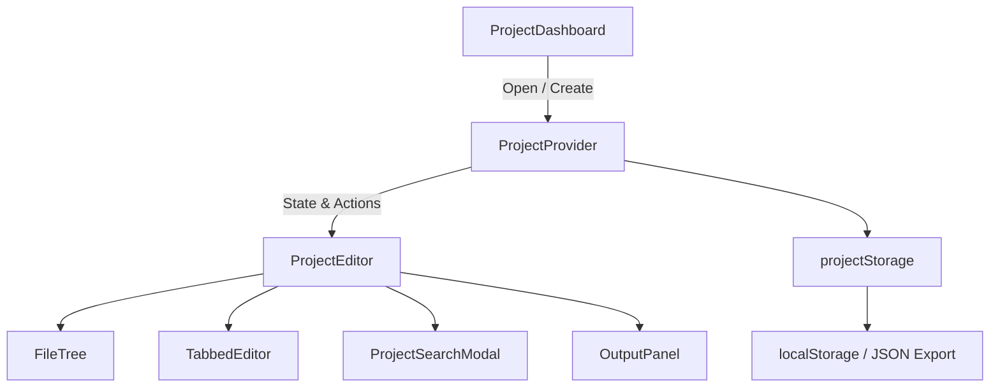

# Multi-File Project System - Architecture & User Guide

## Overview

CodeBuddi provides a browser-based, multi-file project development environment with localStorage persistence, pre-configured project templates, recursive file tree management, tabbed Monaco editing, keyboard shortcuts, and full export/import capabilities.

---

## Architecture

### Core Components

1. **`ProjectContext` (`Frontend/src/context/ProjectContext.jsx`)**
   - Central React context provider maintaining `projects`, `currentProject`, `openTabs`, `activeFileId`, and auto-save timers.
   - Provides safe file and folder CRUD operations with path reconciliation.

2. **`FileTree` (`Frontend/src/components/FileTree.jsx`)**
   - Recursive tree visualization for project hierarchies.
   - Inline file and folder creation, rename, duplicate, and deletion.
   - Right-click context menus with action dispatching.

3. **`TabbedEditor` (`Frontend/src/components/editor/TabbedEditor.jsx`)**
   - Multi-tab document interface with dirty state tracking.
   - Seamless integration with LazyMonacoEditor for syntax highlighting across 19+ languages.
   - Tab switching, closing, and keyboard navigation.

4. **`ProjectSearchModal` (`Frontend/src/components/ProjectSearchModal.jsx`)**
   - Fast, fuzzy command palette for quick file navigation.
   - Opens via `Cmd/Ctrl + P` shortcut.

5. **`projectStorage` (`Frontend/src/utils/projectStorage.js`)**
   - Persistence layer storing projects under `codebuddi-projects` key in `localStorage`.
   - Pre-packaged templates: React + Vite, Python, Node.js, Go, Rust, and Blank.
   - Robust JSON export and schema-validated import helpers.

---

## Keyboard Shortcuts

| Shortcut | Description |
|---|---|
| `Cmd / Ctrl + P` | Open Quick File Search modal |
| `Cmd / Ctrl + S` | Save active file & project state |
| `Cmd / Ctrl + B` | Toggle File Explorer sidebar |
| `Alt + W` / `Cmd + Shift + W` | Close active editor tab |
| `Cmd / Ctrl + Enter` | Run active file |

---

## Supported Templates

- **React + Vite**: JSX, components, CSS, and `index.html`.
- **Python**: `main.py` entrypoint and `requirements.txt`.
- **Node.js**: Modern ES modules with `package.json` and `index.js`.
- **Go**: `main.go` and `go.mod`.
- **Rust**: `src/main.rs` and `Cargo.toml`.
- **Blank**: Clean slate for custom multi-file setups.

---

## Automated Test Coverage

The multi-file project system is backed by comprehensive Vitest unit test suites:
- `Frontend/src/utils/projectStorage.test.js`: Core CRUD, templates, export/import validation.
- `Frontend/src/utils/fileSearch.test.js`: Recursive flattening and fuzzy path search.
- `Frontend/src/utils/projectStats.test.js`: Line counting and language breakdown metrics.
- `Frontend/src/hooks/useProject.test.jsx`: Hook provider isolation tests.
- `Frontend/src/hooks/useProjectShortcuts.test.js`: Key combination listeners and modifiers.
- `Frontend/src/context/ProjectContext.test.jsx`: Full context reducer state tests.
- `Frontend/src/components/FileTree.test.jsx`: Explorer tree interaction tests.
- `Frontend/src/components/ProjectCard.test.jsx`: Dashboard project card actions.
- `Frontend/src/components/NewProjectModal.test.jsx`: Template wizard validation.
- `Frontend/src/components/ProjectSearchModal.test.jsx`: Search modal filtering & hotkeys.
- `Frontend/src/components/editor/TabbedEditor.test.jsx`: Tab switching and Monaco editor integration.
- `Frontend/src/components/ProjectDashboard.test.jsx`: Projects list, search, and modal triggers.
